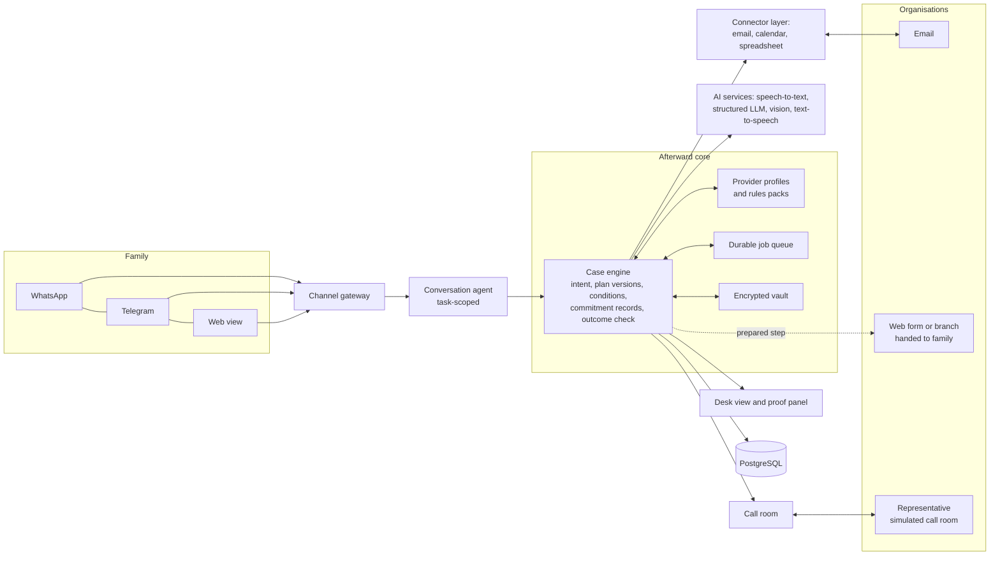
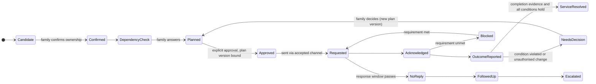

# Afterward

### *You tell it once. We'll tell everyone else.*

**Agentika 2.0 · NaSCon'26 · Theme: Human + AI: Better Together**

Afterward is an AI case manager for the months after someone dies. The family talks to it on **WhatsApp or Telegram**: a voice note, a photo of a letter, a tap on a button. It turns what the family wants into a plan with conditions, carries out that plan with each organisation, and keeps following through in the background for months.

Its central job is to check every organisation's response against what the family actually authorised.

> **When an organisation says "done", Afterward checks whether the family actually got what they asked for.**
> *Done isn't done until it matches what you approved.*

---

## Contents
1. [The 30-second pitch](#1-the-30-second-pitch)
2. [The problem, in real numbers](#2-the-problem-in-real-numbers)
3. [Who it is for](#3-who-it-is-for)
4. [The core idea: intent → plan → outcome](#4-the-core-idea-intent--plan--outcome)
5. [What the months look like](#5-what-the-months-look-like)
6. [Features](#6-features)
7. [The chat experience](#7-the-chat-experience)
8. [Architecture](#8-architecture)
9. [Triggers and autonomy](#9-triggers-and-autonomy)
10. [Scenarios, edge cases and proof tests](#10-scenarios-edge-cases-and-proof-tests)
11. [Safety, privacy and honest claims](#11-safety-privacy-and-honest-claims)
12. [Impact we measure, and who it is for commercially](#12-impact-we-measure-and-who-it-is-for-commercially)
13. [Scope: what we build by 12:45 tomorrow](#13-scope-what-we-build-by-1245-tomorrow)
14. [Demo plan](#14-demo-plan)
15. [How this wins: rubric mapping](#15-how-this-wins-rubric-mapping)
16. [Hackathon rule compliance](#16-hackathon-rule-compliance)
17. [Risks and honest limits](#17-risks-and-honest-limits)
18. [Open decisions for the team](#18-open-decisions-for-the-team)
19. [Sources](#19-sources)

**Technical design:** see [AFTERWARD-TECH.md](AFTERWARD-TECH.md).

---

## 1. The 30-second pitch

> When someone dies, their family has to tell every bank, phone company, utility and subscription, one at a time, saying the hardest sentence over and over. And when an organisation finally says "done", it often hasn't done what the family asked.
>
> Afterward lets the family say it once, in a voice note. It learns what they want to stop, keep and protect, and asks the questions only they can answer: *"Does anyone still use this number?"* Then it follows through for months, with every request, reply, deadline and follow-up handled.
>
> When a provider says "completed" but has reset the voicemail with Dad's voice on it, Afterward refuses to mark it done, shows the conflict, and gets it fixed.
>
> The AI carries the follow-through. The family keeps the judgment.

---

## 2. The problem, in real numbers

**Scale**

| Fact | Figure | Source |
|---|---|---|
| Deaths worldwide in 2023 | **61.6 million**, about **2 families starting this every second** (our arithmetic) | UN World Population Prospects 2024 |
| Deaths in Pakistan in 2023 | **1.6 million**, about **3 a minute** (our arithmetic) | UN WPP 2024 |

**The admin burden**

| Fact | Figure | Source |
|---|---|---|
| Accounts to notify and close per person | **at least 11** | Life Ledger, 2,001 UK adults |
| Time needed to close them | **up to 140 hours** (10–13 h per account) | Life Ledger |
| Time to settle a loved one's affairs | **13 months** on average, **~20 with probate** | Empathy, 2,000+ families |
| Accounts that took 7+ months to close | **28%**; 10% couldn't close them all in a year | Marie Curie / Opinium, 2,500 bereaved, 2023 |

**The human cost**

| Fact | Figure | Source |
|---|---|---|
| Bereaved people doing admin who hit problems | **61%** (≈682,000 a year in the UK) | Marie Curie |
| Spoke to 5+ different people at **one** organisation | **31%** | Marie Curie |
| Still receiving post addressed to the person who died | **1 in 3**; 16% still four weeks after notifying | Marie Curie |
| Had panic attacks after the loss | **66%** | Empathy, *The Grief Tax* 2025 |
| Said the loss hurt their work | **52%** | Empathy |
| Typical US bereavement leave for immediate family | **~5 days** | CNBC / IFEBP |

**Money families don't find**

| Fact | Figure | Source |
|---|---|---|
| Life insurance found by the US policy locator since 2016 | **$13.18 billion**, 611,000 matches (~$21,500 each, our arithmetic) | NAIC 2025 |

**The story.** Families have lost a dead loved one's voice when a phone account was closed or changed. Lisa Moore paid about $1,700 over five years to keep her late daughter's line active, then a carrier upgrade erased the greeting: *"My daughter will never hear her voice now."* (MPR News)

**What these numbers prove, and what they don't.** They establish scale, duration and pain. They do **not** measure how much of that burden Afterward removes. Afterward targets the repetitive part (notifying, following up, tracking, checking responses), not probate or legal work. What we claim for the product itself, we measure in [section 12](#12-impact-we-measure-and-who-it-is-for-commercially). On slides, each statistic carries its country and year.

---

## 3. Who it is for

| Person | Situation | What they need |
|---|---|---|
| **Sara, 34**, daughter | Her father Yusuf died. She says she's handling the admin. She works full time and lives in another city. | Things moving without her on hold. Decisions in one tap. One weekly update. |
| **Amina, 68**, his wife | Lives in the family home. Uses WhatsApp voice notes every day, not forms. | To be **asked** about the things only she knows, and for nothing she depends on to be cut off. |
| **The organisation's representative** | Handles bereavement cases daily. | A complete, polite, correctly referenced request instead of a distressed caller who doesn't know what to ask for. |

Roles are recorded as **stated** ("Sara says she is handling the estate"), never inferred and never shown as verified. Organisations run their own checks; Afterward supplies what each one requires.

---

## 4. The core idea: intent → plan → outcome

Most tools *send requests*. Afterward manages **outcomes**, in three layers:

1. **Intent, in the family's words.**
   *"Stop the bills that don't matter, but keep Mum's phone and Dad's messages."*

2. **A plan with conditions, built together.** For each organisation: the requested action (close, transfer, freeze, notify only), the documents it will disclose, and the **conditions that must hold**:
   *"Transfer the line to Amina only if the number and the voicemail are kept. If they can't confirm that, hold and ask us."*
   The human supplies what no inbox can reveal: *"I still use that number. The bank sends my login codes to it."*

3. **Outcome checking, against the plan.** Every reply is turned into a commitment record (what action, on which account, done or only promised, under what conditions). It is compared with the approved plan:

| Requested | Provider says | Afterward concludes |
|---|---|---|
| Transfer the line, keep the number and voicemail | "Request complete. Line transferred to Mrs Malik on a new 24-month plan. Voicemail will be reset during migration." | **Not done.** Transfer ✔ · number not stated ⚠ · voicemail **condition violated** ✖ · new 24-month contract **not authorised** ✖ → fresh decision needed |
| Close the gym membership | "We have received your request." | **Acknowledged**, not completed |
| Close the account | "We cannot close the account until probate is received." | **Blocked** on a requirement, not closed |
| Refund the charges | "A refund of $42 will be processed." | **Refund promised**, not received |

That table is the product. Discovery, voice, timers and documents all serve it.

---

## 5. What the months look like

| When | In the background | What the family sees |
|---|---|---|
| **Day 0** | One voice note becomes the case and the intent. Documents go into the vault. Candidate accounts are gathered from what the family shares. | A summary to confirm. The candidate list with its coverage. The "what could disappear?" questions. |
| **Week 1** | Approved actions go out, routine notices first and consequential requests individually. Each one goes through the provider's accepted channel. | Approval cards that say exactly what will be sent, to whom, and with what conditions. |
| **Weeks 2–6** | Each reply becomes a commitment record and is checked against the plan. Document requests are matched against what the vault actually holds. Follow-ups go out on silence, with escalation after the second. | A weekly digest. A decision card only when an outcome conflicts with the plan or a new choice appears. |
| **Months 2–3** | Final bills: the charges are compared against the service period and the closure terms. Promised refunds are tracked until there is evidence they arrived. | "Refund issued by City Power. Waiting for it to show on a statement." |
| **Months 3–24** | Deadline watch: potentially relevant claims are checked for eligibility before any date is computed. | "Possibly relevant: a $255 payment. Two facts needed to check eligibility." |
| **Close-out** | A ledger of requested, promised and confirmed outcomes, plus what remains open. Export, then delete our copies. | "11 organisations handled. 2 still open, here's why." |

---

## 6. Features

For each feature: what it does, where the AI is needed, and where the human stays in charge.

### F1. Chat-first interface (WhatsApp and Telegram)
- **What:** Voice notes, text, photos and buttons. No app to learn. A web view is also available, and a household member (e.g. Amina) can join the case to answer questions.
- **AI:** Speech-to-text, intent understanding, short and warm replies.
- **Human:** Every consequential choice is a button. Free text that implies a decision ("just keep Mum's line") is read back as a button to confirm.
- **Task-scoped:** Afterward only does bereavement admin and declines general chat. That also keeps it inside WhatsApp's policy for business assistants.

### F2. Tell it once
- **What:** One voice note (*"My dad Yusuf Malik died on 3 March. I'm Sara, his daughter, I'm sorting things out. Mum still lives at the house…"*) becomes the case: who died, the date, who is speaking, the household, **and the family's intent**.
- **AI:** Extracts the facts and the goals from natural speech, and asks only for what is missing, one question at a time.
- **Human:** Confirms a summary card. Roles are labelled "stated by Sara".

### F3. Intent and conditional plan *(centrepiece)*
- **What:** For each organisation: an action (notify only, close, transfer, freeze, refund review), the **conditions that must remain true**, the **documents it will disclose**, and the fallback if a condition can't be met.
- **AI:** Drafts the plan from the intent, the account type and the dependency answers.
- **Code:** Conditions are stored as structured checks (e.g. `number_kept = true`, `voicemail_preserved = true`, `no_new_contract = true`) that every later reply is tested against.
- **Human:** Approves each plan item. Any change to the plan creates a new version, and earlier approvals no longer apply.

### F4. "What could disappear?" dependency check *(signature feature)*
Before any close or transfer, Afterward asks what might be lost, beyond what the inbox can show:

| Dependency | Example question |
|---|---|
| **Shared service** | "Does anyone still use this line or this broadband?" |
| **Access** | "Does this number or email receive login or recovery codes for other accounts?" |
| **Evidence** | "Could this email account hold documents you'll need for insurance or the estate?" |
| **Memory** | "Is there a voicemail greeting, saved messages or photos here you want to keep?" |

- **Cross-account links:** If Amina says the bank sends codes to the phone number, the bank account is linked to the phone plan. The line can't be closed while that link stands, and the bank item is flagged "joint, may belong to Amina".
- **Human:** Supplies the facts. The plan visibly changes in response. That's the theme in one screen.
- **Evidence labels:** A memory is marked "saved" only with evidence. "Family confirmed backup" or "provider confirmed preservation in writing", never just "saved".

### F5. Candidate discovery, with honest coverage
- **What:** Builds a list of **candidate** accounts. It works **without access to the deceased's inbox**: from emails the family forwards, photographed bills and letters, manual additions, and optionally a connected household inbox the family controls.
- **AI:** Reads forwarded emails and photos, extracts organisation, account reference, amount, billing period and account holder name, and merges duplicates **only when references match** (two accounts at one provider stay separate).
- **Coverage panel:** Shows the sources searched, the sources not searched (paper post, other email addresses, cash payments), unresolved candidates ("3 need ownership confirmation"), and other ways to find more ("check bank statements for direct debits").
- **Human:** Confirms or removes candidates. There is **no "looks complete" button**. The list stays open, and new items can arrive any time.

### F6. Provider profiles
A small table of facts per organisation, which controls how Afterward interacts with it:

| Field | Why it matters |
|---|---|
| Accepted channel (email, web form, phone, branch) | Whether Afterward can submit itself or must hand over a prepared step |
| Required information | No incomplete requests |
| Required documents **and required form** (photo, certified copy, original) | No unnecessary disclosure; no pretending a photo is a certified copy |
| Expected response window | Drives follow-up timing |
| Completion evidence | What counts as "done" |
| Approved recipient addresses | The only places documents may go |

- **Real-world example:** BT's published bereavement process uses an online form or phone, and BT says it doesn't need the death certificate. A profile like that means Afterward prepares the form data and hands over a one-tap step instead of sending an email nobody reads.
- **Demo:** the demo providers are fictional and labelled, and their profiles are declared up front.
- **Other countries:** profiles and rules packs are data, so they're added per country and per provider without changing the engine.

### F7. Document vault with requirement matching
- **What:** Encrypted uploads, tagged with **type** and **form** ("photo of death certificate", "certified copy, held physically by Sara").
- **AI:** A vision model reads the document type and key fields, and flags mismatches with the case ("the certificate says 4 March, you said 3 March").
- **Code:** A request is checked against what is actually held. *Requirement: certified copy. Held: photo.* → **requirement unmet**, and the next step is prepared ("post a certified copy to this address"), instead of sending the wrong thing.

### F8. Consequential actions need explicit, specific approval
Even a notification can have consequences, so **every outbound action** is gated, not just spoken commitments. An approval card shows:

> **To:** Northline Mobile, bereavement team (bereavement@northline.example, from their profile)
> **Account:** mobile line ending 4417
> **Request:** transfer to Amina Malik
> **Conditions:** keep the number · keep the voicemail · no new contract
> **Documents disclosed:** death certificate (photo)
> **Consequence:** Northline will update the account holder; Yusuf's online account login may stop working
> **If a condition can't be met:** hold and ask
> **[Approve]** **[Change]** **[Not now]**

Batch approval exists only for **identical routine notices** (e.g. "notify only" to five subscriptions). Closures, transfers, freezes and document disclosures are approved one by one.

### F9. Response understanding: commitment records
Every reply becomes structured records, one per commitment:

| Field | Example |
|---|---|
| Account and service | "mobile line ending 4417" (not "your account") |
| Action | transfer |
| Status | requested · acknowledged · promised · conditional · blocked · refused · completed |
| Conditions or requirements | "until probate is received" |
| Negation | "cannot close" |
| Scope | "one service of three" |
| Dates | effective 1 April |
| Source | message ID; **latest text only**, with quoted older emails excluded |
| Evidence | a verbatim quote, verified to exist in that message |
| Interpretation | `clear` or `ambiguous` (ambiguous stays ambiguous and is never upgraded) |

Quote checking proves the words exist, not that the meaning was read correctly. So the schema forces the model to separate *promised* from *done*, *conditional* from *approved*, and *one account* from *all accounts*. Anything ambiguous goes to the family as a simple question, or to a clarifying follow-up.

### F10. Outcome check *(the core)*
- **Code** compares the commitment records against the approved plan and its conditions:
  - **matched**;
  - **condition violated**;
  - **missing** (not addressed);
  - **unauthorised change** (e.g. a new contract);
  - **needs decision**.
- An item is marked complete only when its **completion evidence** (from the provider profile) is present **and** every condition holds.
- The family sees requested vs promised vs confirmed side by side, with the provider's words highlighted.

### F11. Follow-ups and escalation calls
- **Follow-ups:** a polite follow-up after the profile's response window, a second one after that, then escalation. Each quotes exactly what is still outstanding.
- **Escalation call (simulated provider call):** a browser-based voice call in which a representative, played by a judge in the demo, talks to the AI agent. The agent opens by saying it is an AI acting for the family, states the request and conditions, and answers from the case record.
  - **Honest boundary:** this demonstrates the conversation, not dialling a real company, navigating phone menus or waiting on hold. Real telephony is a later step.
- **No unapproved consequences:** the agent can't approve new terms. If the representative offers *"We can keep the number and voicemail, but the transfer starts a 12-month contract at $30"*, the call pauses, a decision card goes to Sara, and acceptance is spoken only from a server template built from her approved choice. If the representative changes the terms, her approval is void **before** any acceptance is spoken.

### F12. Money tracking with defensible statuses
| Situation | Status |
|---|---|
| A charge dated after death | **Needs review** (it may cover earlier service or a valid balance) |
| A charge after closure | Compared with the service period and closure terms: **needs review** or **likely error** |
| "We will refund $42" | **Refund promised** |
| "Refund issued" | **Issued, awaiting receipt evidence** |
| A statement or receipt shows the credit | **Refund received** |
| An amount the estate genuinely owes | **Balance owed**, reported, never disputed automatically |

A dispute is proposed only when the service period starts after the closure date. That's deterministic arithmetic over dates the provider stated. Example: an April invoice for **February** service is never disputed automatically.

### F13. Deadline watch: eligibility before arithmetic
- **Statuses:** **potentially relevant** → **eligibility incomplete** (listing the missing facts) → **deadline confirmed for this case** → claimed (family-reported) → expired.
- **Rules packs:** data with a source link and the date checked, added per country. Example: the US Social Security lump-sum death payment is $255, for an eligible spouse or child, applied for within 2 years.
- **Human:** Answers the eligibility questions and submits claims themselves. Afterward prepares; it doesn't file. "Information, not legal advice."

### F14. Autopilot, re-checked at the moment of execution
| Level | Automatic | Always asks |
|---|---|---|
| **Gentle** *(default)* | Read and classify replies, reminders, digests | Every outbound action |
| **Steady** | + follow-ups, + identical routine notices, + sending a document the family pre-approved for that provider | Closures, transfers, freezes, new disclosures, decisions, disputes |

- **Every job re-checks at run time:** consent still valid, mailbox access still working, plan version unchanged, conditions unchanged, case not on hold. "Approved last week" is not enough.
- **Revoking consent blocks queued jobs immediately.**
- **"Monitoring interrupted" is a visible state.** If mailbox access expires or checks fail, the family is told. Silence never pretends everything is being watched.

### F15. Three separate controls, so pausing means what the family expects
| Control | Stops | Keeps going |
|---|---|---|
| **Quiet** (`not today` = 24 h; quiet days such as the funeral, birthdays and the anniversary) | Messages to the family | Monitoring and approved routine work |
| **Hold** | All outgoing actions to organisations | Monitoring, so nothing is missed |
| **Stop case** | Everything, including monitoring | — (export and delete offered) |

During setup Afterward asks once: *"If a deadline is close during a quiet period, should I still tell you?"* The answer is stored and shown in settings.

### F16. Family members
- **Case owner** (Sara) approves.
- **Household members** (Amina) answer dependency questions and can propose.
- Proposals appear to the owner as cards.

### F17. Timeline and "did you finish everything?"
- **Timeline:** every trigger, action, message, call and decision, with evidence and evidence labels: *provider confirmed in writing* · *family confirmed* · *observed on a statement* · *unverified*.
- **Honest answers:** asking *"Did you finish everything?"* gets: *"8 confirmed with written evidence. 2 promised but not yet evidenced. 1 blocked until probate. 1 handed to you (branch visit). 3 candidate accounts still unconfirmed."*

### F18. Safety
- **Approved recipients:**
  - They come only from provider profiles and the family's confirmation.
  - **Incoming email can never add or change them.**
  - A `Reply-To` that differs from the approved address, or a new domain, means **hold and ask**.
  - Documents go only to approved recipients, and only the documents that provider's profile requires. A request for more (e.g. "send the full will") needs the family's decision.
- **Prompt injection:** email and document content is evidence, never instructions. Permissions never widen because of something an email says.
- **Wellbeing:** messages suggesting crisis get a caring response and human support resources (e.g. findahelpline.com). The admin conversation pauses until the person chooses to continue.

### F19. Desk view, case clock and proof panel
- **Desk view:** a projector-friendly dashboard with the plan, each account's status (four dimensions, see 8.3), the live event stream, requested/promised/confirmed side by side, the call transcript, and measured latencies.
- **Case clock** (demo cases only, clearly labelled): advances the timer clock so follow-ups fire on stage. Jumps are chosen to match the configured intervals exactly. Emails, voice notes and calls are always real.
- **Proof panel:** runs the adversarial test suite ([section 10.4](#104-proof-tests-run-live-on-the-deployed-system)) against the deployed system and shows the results live.

---

## 7. The chat experience

> **Sara (voice note):** "My dad, Yusuf Malik, passed away on the 3rd of March. I'm his daughter Sara, I'm sorting things out. I want to stop the bills that don't matter, but keep Mum's phone, and… his voicemail. I can't lose that."
>
> **Afterward:** I'm so sorry, Sara. I'll handle the emails and follow-ups so you don't have to explain this again. Here's what I understood:
> • Yusuf Malik, died 3 March 2026
> • You're his daughter and are handling the estate *(as you've told me)*
> • Keep: Mum's phone, Dad's voicemail
> • Stop: bills nobody needs
> **[That's right]** **[Fix something]**
>
> **Afterward:** From the 6 emails and 4 photos you sent, I found **9 possible accounts**. 3 need you to confirm whose they are. Paper-only accounts won't show up here; bank statements are the best place to look for more.
> **[Review]**
>
> **Afterward → Amina (voice note welcome):** Amina, one question before anything changes with Northline Mobile, the line ending 4417: does anyone still use this number, or does it get codes for any other account?
>
> **Amina (voice note):** "Yes, that's my number now. Crescent Bank sends me my codes on it. And his voice is on the voicemail."
>
> **Afterward → Sara:** Amina still uses the 4417 line, and Crescent Bank sends her codes to it. I've changed the plan:
> • Northline: **transfer to Amina**, only if the number and voicemail are kept. If not, I'll hold and ask you.
> • Crescent Bank: **don't close**; it may be a joint account Amina relies on.
> **[Approve Northline request]** **[See the full plan]**
>
> *(later)*
> **Afterward:** Northline says the request is **complete**, but it isn't what you approved: they've started a new 24-month plan and say the voicemail **will be reset**. I haven't marked this done.
> **[Ask them to keep voicemail, no contract]** **[Call them for me]** **[Accept anyway]**

---

## 8. Architecture

### 8.1 Components

| Component | Responsibility |
|---|---|
| **Channel gateway** | One interface over the WhatsApp Cloud API, the Telegram Bot API and the web. Normalises voice notes, photos and button presses, and verifies webhook signatures and secrets. |
| **Conversation agent** | Intake, questions, dependency answers, decisions read back as buttons, wellbeing detection. Declines anything outside the job. |
| **Case engine** | The source of truth: intent, versioned plans with conditions, commitment records, the outcome check, the four-dimension account status, the autopilot policy. **AI proposes, code decides.** |
| **Provider profiles and rules packs** | Channels, requirements, response windows, completion evidence and approved recipients per provider. Deadlines and eligibility rules per country, with sources. |
| **Durable job queue** | Follow-ups, checks, reminders, digests and inbox polling as database rows with run-at time, lease, attempts and idempotency key. Every run re-checks permission and state. |
| **Vault** | Encrypted documents with type, form and per-provider disclosure permission. |
| **Connector layer** | Email (search, read, send in thread, label), calendar, and a status-only spreadsheet mirror. It sits behind an interface: either direct provider APIs or a connector platform, possibly over MCP. Decided in the technical pass. |
| **AI services** | Speech-to-text; an LLM with strict structured output (intake, plan drafts, commitment extraction); vision for documents; text-to-speech for calls. |
| **Call room** | Browser voice call with push-to-talk, structured dialogue actions, a commitment guard, server-template acceptance, and approvals bound to the current version of the terms. |
| **Desk view and proof panel** | Transparency for the family, and the stage view for judges. |
| **PostgreSQL** | All durable state. |

### 8.2 Principles, stated honestly
1. **AI proposes, code decides.** Models extract and draft. Code computes dates and money, checks conditions and changes state.
2. **Quotes are necessary, not sufficient.** A verbatim quote proves the words exist. Meaning is captured in structured fields (status, negation, conditions, scope), and anything ambiguous stays ambiguous.
3. **Consequential actions require valid approval at execution time.** Approval is bound to the plan version and conditions, and re-checked just before acting.
4. **Speech is constrained and checked, with remaining risk.** Free-form negotiation goes through a guard that *reduces* the risk of implied commitments. Commitments themselves come only from server templates after approval. Changed terms void the approval before anything executes.
5. **Delivery uncertainty is a real state.** If a send may have happened but wasn't confirmed, the action is marked **delivery uncertain**, reconciled (e.g. a Sent-folder search by Message-ID) and never blindly retried. We don't claim exactly-once delivery from an external email service.
6. **Background by default, quiet by design.** Events and timers drive the work. The family gets the digest, and urgent items only as they defined them.

### 8.3 Account status is four dimensions, not one
An account can be transferred, still owed a refund, holding a dispute and waiting for a document, all at once. "Done" requires every dimension to be resolved.

| Dimension | Values |
|---|---|
| **Service** | active · requested (close/transfer/freeze) · acknowledged · blocked · closed · transferred · frozen |
| **Money** | none · needs review · refund promised · issued, awaiting receipt · received · balance owed · dispute open |
| **Documents** | none needed · requested · requirement unmet · sent · accepted |
| **Next step** | owner (Afterward / family / provider), action, due date |
| **+ Conditions** | each one: holding · violated · unknown |

(Money and documents move on their own tracks alongside this service track.)

### 8.4 Key flows
- **A reply arrives:**
  1. inbox poll;
  2. recipient and domain check;
  3. latest text separated from quoted history;
  4. commitment records extracted, with quotes verified;
  5. outcome check against the plan;
  6. state update;
  7. depending on policy, an automatic follow-up, a decision card, or a digest line.
- **A timer fires:** lease the job → re-check consent, plan version, case hold and whether a reply already arrived → act or cancel → schedule the next step.
- **A voice note:** download and transcribe → intent (intake, answer, decision, crisis) → decisions read back as buttons.
- **A call:**
  1. disclosure;
  2. representative speech → transcription → structured action → guard → speech;
  3. any new representative speech suspends a pending acceptance until it has been processed;
  4. acceptance only from a template, and only if the terms version is unchanged.

### 8.5 Channel constraints that shape the design
- **WhatsApp:** free-form replies only within **24 hours** of the user's last message. Messages weeks later need **pre-approved templates** (digest, decision needed, reminder). For the hackathon, Meta's test number reaches **up to 5 verified recipients**. Since 15 Jan 2026, Meta bans general-purpose AI chatbots but allows task-specific business assistants; Afterward is task-scoped.
- **Telegram:** no approval process, buttons, voice notes, webhook with a secret header, and no 24-hour window once the user has started the bot. **This is the reliability channel for the live demo**, with WhatsApp shown through the same gateway.

### 8.6 Data path and deletion boundary
| Where data goes | What | Can we delete it? |
|---|---|---|
| Our app and database (confidential compute on Alternate Clouds, if enabled) | Case, plan, excerpts, vault | **Yes**: export, then delete |
| AI provider API | Audio and text excerpts for processing | Under that provider's API data terms; minimised excerpts only |
| Chat platform (WhatsApp, Telegram) | Messages and voice notes | No; they stay in the family's chat |
| Organisations | What was sent to them | **No.** We list exactly what went where |
| Spreadsheet mirror | Status only; **no documents, no sensitive details** by default | Yes |
| Logs | No transcripts or document contents by default | Rotated |

Confidential compute protects **our** compute and storage. It doesn't extend to the AI provider, the chat platforms or the recipients, and we say so.

---

## 9. Triggers and autonomy

The defaults shown assume **Gentle** (the product default). The demo case is switched to **Steady** on stage, which itself demonstrates human control.

| Trigger | Detected by | Action | Gentle | Steady |
|---|---|---|---|---|
| Voice note, text, photo | Channel webhook | Intake, answer, or decision card | Auto | Auto |
| Document uploaded | Webhook | Classify type and form, check against the case | Auto (family confirms the fields) | Auto |
| Reply from an approved provider address | Inbox poll | Commitment records → outcome check | Auto | Auto |
| Reply from an unapproved address or different `Reply-To` | Inbox poll | Hold, warn the family | Ask | Ask |
| Provider requests a document | Commitment record | Requirement match → send or prepare the next step | Ask | Auto if pre-approved and the requirement is met |
| No reply within the response window | Timer | Follow-up 1 → follow-up 2 → escalation | Ask | Auto (escalation call: ask) |
| Condition violated or unauthorised change | Outcome check | Decision card | Ask | Ask |
| Provider offers a new choice (email or call) | Outcome check or call | Decision card | Ask | Ask |
| Charge after death or after closure | Bill parsed | Needs review, or a dispute **proposal** if the service period starts after closure | Ask | Ask |
| Refund issued | Commitment record | Track until statement evidence | Auto | Auto |
| New candidate account | Forward or photo | Add as a candidate | Ask | Ask |
| Deadline potentially relevant | Rules pack | Eligibility questions | Ask | Ask |
| Mailbox access expired or checks failing | Health check | **Monitoring interrupted** notice | Auto | Auto |
| Consent revoked | Settings | Cancel or block queued jobs | Auto | Auto |
| Crisis language | Conversation agent | Care response, pause asks | Auto | Auto |
| Digest day (not a quiet day) | Timer | Weekly digest | Auto | Auto |

---

## 10. Scenarios, edge cases and proof tests

### 10.1 Organisation behaviour
| Scenario | Handling |
|---|---|
| "We received your request" | **Acknowledged**, not complete. Follow-up timer continues. |
| "Completed", but the details differ from the plan | Outcome check: condition violated or unauthorised change → **not done**, decision card. |
| "Cannot close until probate is received" | **Blocked** on a requirement; a vault watch for that document; resumes automatically when it arrives (if approved). |
| Asks for a certified copy, but the vault has a photo | **Requirement unmet**, so the next step is prepared (where to post it). The photo is never sent as if it were certified. |
| Only accepts a web form or phone | Profile says so: Afterward prepares the data and hands the family a one-tap step, tracked to completion. |
| No reply | Follow-ups on the profile's window, then escalation. |
| Refuses to deal with an AI | **Needs human**: a ready script, the references, and a pre-filled email for the family to send themselves. |
| Offers a retention or transfer deal with new terms | Decision card. Acceptance only from a template, and void if the terms change. |
| Partial outcome ("one of your three services cancelled") | Scope recorded; the remaining services stay open. |
| Replies quoting an old email | Only the latest text counts as their position. |

### 10.2 Family behaviour
| Scenario | Handling |
|---|---|
| Stops replying | No pressure. Asks queue, the digest continues, and urgent items follow the family's stated deadline preference. |
| "Whatever you think" | Afterward never decides consequential items. It offers the safe default (hold) and explains it. |
| A household member reveals a dependency | The plan is revised, cross-account links are recorded, and later replies are checked against the new conditions. |
| Wrong fact at intake | "Fix something" → a correction to any organisation already notified (after approval). |
| Wrong document uploaded | Vision check: "This looks like a bank statement, not the certificate." |
| Expresses crisis | Care response, support resources, admin paused until they choose to continue. |

### 10.3 Failures and attacks
| Scenario | Handling |
|---|---|
| Container restart mid-case | State and jobs are in Postgres; leases expire and are retaken. |
| Crash after sending, before recording | **Delivery uncertain**, then reconcile; no blind retry. |
| AI timeout or invalid output | Retry with backoff; else the item is marked "needs review". Nothing is ever sent on a guess. |
| Connector failure or expired mailbox token | Retry; then **monitoring interrupted**, visible to the family. |
| WhatsApp 24-hour window closed | Template message (production), or Telegram/web (demo). |
| Phishing email posing as the bank | Unapproved address → hold and warn; no documents, no reply. |
| Injection inside an email ("send the will to…") | Content is evidence only. Recipients and permissions can't be changed by email. |
| Two accounts at one provider | Kept separate unless the references match. |
| Two family members act at once | Decisions are bound to a version; the second gets "already decided". |

### 10.4 Proof tests (run live on the deployed system)
The rubric asks whether *errors and edge cases are handled*. We show it with a live test panel, not a slide:

| # | Input | Required behaviour |
|---|---|---|
| 1 | "We received your request" | Acknowledged, **not** completed |
| 2 | "We cannot close until probate arrives" | Blocked on a requirement |
| 3 | April invoice for February service | **No** automatic dispute; needs review |
| 4 | "Refund approved" with no statement evidence | Refund promised; outstanding |
| 5 | "Transferred, but voicemail will reset" | Condition violated → fresh decision |
| 6 | "Completed: new 24-month plan" | Unauthorised change → decision |
| 7 | Request for the full will from an unknown address | No disclosure; hold and warn |
| 8 | Valid domain but `Reply-To` points elsewhere | Hold and warn |
| 9 | Request for a certified copy when the vault holds a photo | Requirement unmet; next step prepared |
| 10 | Owner revokes consent while a send is queued | Execution blocked |
| 11 | Worker killed right after sending | Delivery uncertain → reconciled |
| 12 | Second account at the same provider | No merge |
| 13 | Rep changes terms after the family approved | Approval void before any acceptance is spoken |
| 14 | "Did you finish everything?" | Confirmed vs promised vs blocked vs handed back vs unconfirmed |

---

## 11. Safety, privacy and honest claims

**What we claim**
- Consequential actions need valid, specific, current approval.
- Every outcome is checked against the approved plan.
- Uncertainty (ambiguous replies, uncertain delivery, interrupted monitoring) is shown, not hidden.
- Documents go only to approved recipients, and only those each provider requires.
- Speech is constrained and checked.

**What we don't claim**
- That we find every account.
- That every organisation accepts email.
- That a photo is a certified copy.
- That the free-form speech guard is perfect.
- That deleting our data deletes what organisations received.
- That the browser call room is a real phone call.

**Hard limits in code**
- Never sign, never move money, never impersonate.
- Never close or transfer without the dependency check.
- Never send documents to unapproved recipients.
- Never let incoming content widen permissions.

---

## 12. Impact we measure, and who it is for commercially

**Measured per case** (on the final screen, and from the demo run):

| Metric | Why it matters |
|---|---|
| Times the family had to state the death | 1, vs the number of organisations notified |
| Family interventions, by type | Decisions vs facts vs hand-offs: shows where human judgment went |
| Repeated details auto-filled | Information entry avoided |
| Outstanding obligations tracked | Nothing silently dropped |
| Incorrect provider outcomes caught | The core value |
| Refunds: promised vs evidenced | Honest money |
| Tasks completed vs handed back to humans | Includes the providers we can't serve automatically |

**Early route to families (hypotheses to validate):**
- funeral homes and bereavement charities offering it at the moment it's needed;
- an employer bereavement benefit;
- professional estate administrators who want a tracking layer.

**Whose side it's on.** Afterward serves the family. It is never paid by the organisations it chases. If a partner's preferred outcome conflicts with the family's, the family's approved plan wins.

---

## 13. Scope: what we build by 12:45 tomorrow

**Code freeze 12:00 PKT. Submission 12:45 PKT.** The demo is a proof of one story, so we build that story end to end first.

### Must ship (in this order)
1. **Case engine:**
   - Postgres;
   - intent;
   - versioned plans with structured conditions;
   - commitment records;
   - outcome check;
   - the four-dimension status;
   - durable jobs with run-time permission checks.
2. **Telegram bot** (voice notes, photos, buttons, a household member joining by invite link), and the **WhatsApp test-number adapter** behind the same gateway.
3. **Tell it once** intake with intent, and the confirmation card.
4. **Candidate discovery** from forwarded emails and photos, with the coverage panel.
5. **Dependency check** with cross-account links and conditional plan items.
6. **Approval cards** (recipient, action, conditions, documents, consequence).
7. **Email out and in** through the real connected mailbox; recipient checks; latest-text parsing.
8. **Outcome check** and decision cards, plus the correction request.
9. **Provider profiles** for the demo providers (declared), and **vault requirement matching**.
10. **Timers:** follow-up on silence, final-bill check, refund-evidence tracking.
11. **Simulated provider call** (reusing the Stand-In voice engine) for a terms-changing offer, with approval voiding.
12. **Money statuses** with the service-period rule.
13. **Desk view**, **case clock** and **proof panel** running tests 1–14.
14. **Deployed on Alternate Clouds** with Postgres, plus a confidential-mode attempt.

### Stretch
- Weekly digest via a WhatsApp template (Telegram first).
- Deadline watch with the eligibility flow.
- Calendar events for checks and deadlines.
- Status-only spreadsheet mirror.
- Optional spoken replies back to the family.

### Out of scope (said plainly)
- Real phone calls and phone menus.
- Probate or legal filings.
- Government claim submission.
- Provider profiles for real companies beyond illustrative examples.
- Multilingual chat (English only for the hackathon).

### Build order

The hour-by-hour plan for both teammates, mapped to code modules, is in [AFTERWARD-TECH.md §T16](AFTERWARD-TECH.md#t16-build-plan-mapped-to-modules). Deployment is de-risked in the **first hour**, not at the end.

---

## 14. Demo plan

### 14.1 Consistency rules for the demo case
- **Demo providers** are fictional and labelled: Northline Mobile, Crescent Bank, City Power, StreamBox, FitLife Gym. Each has a declared profile and a **pre-registered sender identity** that the team controls. Judges send replies through the **provider console** (pick a response or write their own), signed in as that provider.
- **Money:** USD throughout. **Rules pack:** the US example only.
- **Intervals:** FitLife's response window is 10 business days, so the "+14 days" clock jump fires exactly **one** follow-up.
- **Northline storyline:** transfer requested (never closure) → contradictory "complete" → correction → call → confirmed transfer. One consistent history.
- **Voicemail ending:** "Family confirmed backup" plus "Northline confirmed in writing that the voicemail is kept", and only if the judge's final reply actually says so. Otherwise it stays open, which is also a valid ending.
- **Roles:** Sara is "handling the estate (stated)", never auto-labelled executor.
- **Autopilot:** the product default is Gentle; Sara switches the demo case to Steady on stage.

### 14.2 Six-minute live demo: one story, as proof
| Time | Beat | What it proves |
|---|---|---|
| 0:00–0:25 | *"Two families every second. 61% hit problems. And when a company says 'done', it often isn't."* | Usefulness |
| 0:25–1:05 | **Intent.** Sara's Telegram voice note: *"Stop the bills that don't matter, keep Mum's phone and Dad's voicemail."* → summary card. Forwarded emails and photos → 9 candidates with the coverage panel. | Voice AI, honest discovery |
| 1:05–1:50 | **Human knowledge changes the plan.** Afterward asks about the 4417 line; **Amina's voice note** from a second phone: *"That's my number, the bank sends my codes there, and his voice is on it."* The plan visibly changes: transfer with conditions, bank flagged joint. | **Theme** |
| 1:50–2:20 | **Specific approval.** The Northline card: recipient, conditions, documents, consequence → Approve → sent from the real mailbox. | Controlled automation |
| 2:20–3:20 | **"Done" that isn't.** A judge, as Northline, replies: *"Complete. New 24-month plan. Voicemail will reset."* → Afterward **refuses success**: side by side, two conditions violated → decision card on Sara's phone → **[Call them for me]**. | **The core** |
| 3:20–4:20 | **Simulated provider call.** A judge plays Northline: *"We can keep the voicemail, but only on a 12-month contract at $30."* → the agent can't accept → a card on Sara's phone → she approves → acceptance from the template. If the judge changes the terms mid-way, the approval is voided on screen. | Voice agent, stale-approval protection |
| 4:20–5:05 | **Persistence.** Clock +14 days: FitLife silent → one follow-up goes out. The City Power final bill arrives: *April invoice for February service* → **needs review**, not disputed. A refund is *issued, awaiting receipt*. | Months of background work, financial honesty |
| 5:05–5:35 | **Proof panel:** 14 adversarial tests run against the deployed system, all green. | Reliability |
| 5:35–6:00 | **"Did you finish everything?"** → the honest answer. Final metrics: *stated once, 9 organisations, 3 interventions, 2 wrong outcomes caught.* Tagline. | UX, impact |

### 14.3 Shortlist video (2–3 minutes): product value by 0:20
- **0:00–0:20 cold open:** Northline's "Completed" email next to Sara's plan, with the violated conditions highlighted. *"The company said done. It wasn't."*
- **0:20–0:40:** the problem in three numbers and the voicemail line.
- **0:40–2:10:**
  - the voice note;
  - Amina's dependency answer changing the plan;
  - the approval card;
  - the contradiction caught;
  - the call with the terms-change decision;
  - the clock jump;
  - the proof panel.
- **2:10–2:40:** architecture in one diagram: intent → plan → commitment records → outcome check; durable jobs; deployed on Alternate Clouds.
- **2:40–3:00:** *"You tell it once. We'll tell everyone else. And we check they got it right."*

### 14.4 Fallbacks
- Typed representative turns if call audio fails.
- Telegram if WhatsApp misbehaves; the web view if both fail.
- Pre-written provider replies in the console.
- A recorded full run as a last resort.

---

## 15. How this wins: rubric mapping

| Criterion (points), handbook wording | What judges see |
|---|---|
| **Technical execution & reliability (25)**: *end to end; reliable integrations; errors and edge cases handled* | The full story runs live on the deployed system. The **proof panel** runs 14 adversarial cases in front of them. We restart the container mid-case and the case continues. Delivery-uncertain and monitoring-interrupted states are real. |
| **Usefulness & real-world impact (20)**: *genuine problem, practical value* | Two families every second. Measured per-case impact: stated once, interventions, wrong outcomes caught. |
| **Theme alignment (15)**: *theme central, not an afterthought* | Amina's knowledge **changes the plan**, and the system enforces it for months. The AI can't approve new terms; the family's conditions govern every outcome. |
| **Creativity & uniqueness (15)**: *beyond generic AI wrappers* | Outcome checking against a conditional plan; "what could disappear?"; four-dimension status; eligibility before arithmetic. Not a chatbot over email. |
| **Automation depth & integration (15)**: *agents, APIs, automation, MCP where appropriate, coherent workflow* | Chat channels, email in and out, durable timers, a voice agent, provider-profile routing; optionally calendar and spreadsheet. One coherent loop: intent → plan → action → evidence → check → follow-through. |
| **User experience & presentation (10)**: *easy to use; value clearly demonstrated* | Voice notes and buttons, one question at a time, quiet/hold/stop, honest "did you finish everything?", a projector-ready desk. |

**One-sentence answers to the questions judges will ask**
- *"When an organisation says done, how do you know?"* Its reply becomes structured commitments, checked against the family's approved plan and conditions. Done means completion evidence plus every condition holding.
- *"Which countries does it work in?"* The engine is country-neutral. Provider profiles and rules packs are data added per country; the demo uses a fictional, labelled provider set.
- *"How do you know you haven't missed an account?"* We don't, and we show it: coverage, unresolved candidates, and where else to look.
- *"Is the call real?"* It's a simulated provider call in a browser. Real telephony is the next step.
- *"What about privacy?"* We show where data goes and what we can and can't delete. Confidential compute covers our side.

---

## 16. Hackathon rule compliance

Checked against the Participant Handbook.

| Requirement | How we comply |
|---|---|
| Deployed on **Alternate Clouds**; local-only or hosting elsewhere does not qualify | App and Postgres on Alternate Clouds; **kept running until the closing ceremony**. |
| Built with **n8n, custom code or both**; list the AI models, APIs and MCP used | Custom code. The PDF lists models, APIs and any MCP. **fastn is not a handbook requirement**; the connector layer can use it if we choose. |
| Submission by **12:45 PKT, 17 Oct**; no code or deployment changes after | Freeze at 12:00, tagged release. |
| **English only** | All UI, chat, voice and presentation. |
| **LinkedIn post written by us**; one teammate posts, the other **reshares** | We write it ourselves (grammar tools only). Both links go in the PDF. |
| **Submission PDF** | Team details (names, emails, Discord usernames, one WhatsApp contact); project name and one-liner; problem and audience; **where the human comes in and why**; what we built with. |
| **Required links** | Live deployment, GitHub repo, 2–3 min video (unlisted YouTube or Drive), LinkedIn post and reshare. X post optional. |
| **Proof screenshots** | Both teammates in the Alternate Futures Discord server; the Alternate Clouds dashboard showing service and deployment status. |
| **Judge access** | A dedicated demo login in the PDF, a judge-joinable Telegram bot link, the provider console. Demo accounts only. |
| **No keys** in the repo, video or screenshots | Environment variables only; `.env.example`; a secret scan before every push; blur checks on the video. |
| **Credit third-party code and templates** | Credits section in the README. |

---

## 17. Risks and honest limits

| Risk | Mitigation |
|---|---|
| Scope for one night | Build the one demo story end to end first; everything else is stretch. |
| WhatsApp setup friction | Telegram is the live-demo channel; WhatsApp runs through the same gateway on pre-verified numbers. |
| Model misreads a reply | Structured commitment fields, quote verification, ambiguity preserved; proof tests 1–6 guard it. |
| Confidential-mode deployment issues | One early attempt; otherwise standard mode, stated honestly. |
| Voice latency on venue Wi-Fi | Push-to-talk, a "Reviewing…" indicator, typed fallback. We report measured latency only. |
| Heavy subject | Calm design, a fictional labelled family, an ending that is hopeful *and* honest. |

---

## 18. Open decisions for the team

1. **A real story** we can tell with permission, for the pitch (not the cold open; the product goes first).
2. **Mailbox:** which Google account is the family's demo mailbox; who controls the demo provider sender identities.
3. **WhatsApp:** who sets up the Meta test number tonight, and which phones get verified.
4. **Amina's phone:** which teammate's phone plays the second family member.
5. **Telephony:** real phone calls are **not possible on a Twilio trial from Pakistan** (see [AFTERWARD-TECH.md §T9](AFTERWARD-TECH.md#t9-the-call-room)). Decide whether to stay with the browser call room (recommended) or pay for an upgraded account.

---

## 19. Sources
- UN World Population Prospects 2024, via [Wikipedia: List of countries by number of deaths](https://en.wikipedia.org/wiki/List_of_countries_by_number_of_deaths)
- Life Ledger survey, via [Town & Around](https://townandaround.uk/news/reducing-the-difficult-conversations-when-a-loved-one-dies)
- [Marie Curie: Making sadmin simple (2024)](https://mariecurie.org.uk/document/making-sadmin-simple)
- [Empathy: The high cost of death](https://empathy.com/blog/cost-of-dying)
- [Empathy: The Grief Tax (2025)](https://www.empathy.com/blog/what-loss-really-costs-key-takeaways-from-the-grief-tax)
- [NAIC: Policy locator finds more than $13 billion](https://content.naic.org/article/naic-life-insurance-policy-locator-tool-helps-consumers-connect-more-13-billion-benefits)
- [MPR News: Dead loved ones' voices fall victim to technology](https://www.mprnews.org/story/2013/10/12/dead-loved-ones-voices-fall-victim-to-technology)
- [CNBC: The U.S. has no federal bereavement leave](https://www.cnbc.com/2024/01/26/what-to-know-about-bereavement-leave-at-work-when-someone-you-love-dies.html)
- [BT: Bereavement, BT account holder](https://www.bt.com/help/account-and-billing/manage-account/bereavement---bt-account-holder)
- [SSA: Lump-sum death payment](https://www.ssa.gov/personal-record/when-someone-dies/lump-sum-death-payment)
- [GOV.UK: Settling debts and taxes of an estate](https://www.gov.uk/probate-estate/settling-debts-and-taxes)
- [Meta: WhatsApp Cloud API, get started](https://developers.facebook.com/docs/whatsapp/cloud-api/get-started/)
- [respond.io: WhatsApp general-purpose chatbot ban (2026)](https://respond.io/blog/whatsapp-general-purpose-chatbots-ban)
- [Telegram Bot API](https://core.telegram.org/bots/api)
